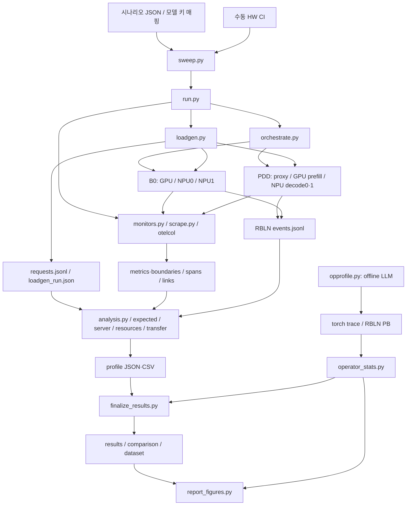

# 설계 명세서

문서 갱신: 2026-11-11. 아래 시험·자료 확인일은 2026-11-10이다.

기준일: 2026-11-10. PLAN v6.2 3·5·7장과 현재 `tools/hetero/`,
엔진 계측 세 파일, COLUMN_DOCS, tests/hetero 및 로컬 실측 메모를 대조했다.
관측 타임라인 시각화는 별도 vllm-profiler 프로젝트에서 다룬다.

## 구성과 책임

| 계층 | 모듈 | 책임·경계 |
|---|---|---|
| 시나리오 | profiler/sweep.py | 쌍 검사, 모델 키 해석, 캐시 조건 해시, 실행·재개·실패 이력 |
| 하네스 | orchestrate.py | 환경·clean 검사, 서버 명령/환경 구성, 기동·정지 |
| 부하 | loadgen.py | FIFO 슬롯, warm-up, SSE 원자료·토큰 ID·헤더 기록; 지표 계산 없음 |
| 실행기 | profiler/run.py | 모드별 역할 추가값, 측정 순서, 정리, 분석 호출 |
| 수집 | monitors.py, scrape.py, otelcol.yaml | 외부 프로세스, 1Hz HTTP 원문·경계, OTLP 파일 저장 |
| 분석 | analysis.py, expected.py, server.py, resources.py, transfer.py, common.py | 검증, ID 연결, 계산·정확도·JSON/CSV |
| 결과표 | finalize_results.py | summary 기반 표, 비교, 데이터셋·사전; loadgen 지표 재계산 안 함 |
| 부하 검증 | overhead.py | 같은 none 서비스에 monitor OFF/ON 블록 실행, PER-001 판정 |
| 연산자 | opprofile.py, operator_stats.py | 온라인 실행과 분리된 단일 장치 LLM 프로파일·무결성·연산/유형 집계 |
| 그림 | report_figures.py | CSV·JSON을 보고서 PNG로 표현; 지표 재측정 없음 |



B0에서는 각 장치가 전체 추론을 수행한다. 슬롯 순서는 gpu/npu0/npu1을 번갈아 배치하고
완료된 슬롯이 다음 요청을 맡는다. PDD proxy는 prefill 뒤 실제 선택한 decoder를
`x-decode-target`으로 반환한다. 클라이언트 요청 번호만으로 decoder를 추정하지 않는다.

## 실행 순서와 디렉터리

실행 경로는 저장소 밖 인자로 받는다. `<service_run>`은 run.py의 --run-dir다.
`service/`는 orchestrate가 빈 폴더 검사를 수행한 뒤 직접 만든다.

| 생성·실행 순서 | 내용 |
|---|---|
| 1 | 실행기가 monitor/를 만들고 도구 검사·단계를 run.json에 기록 |
| 2 (trace/deep) | Collector 먼저 실행; otel/ 생성, OTLP 수신 준비 |
| 3 | orchestrate start에 service/를 전달; 설정·명령·프로세스·로그·캐시 생성 |
| 4 (PDD trace/deep) | 양 decoder의 kv_layout.use_host_buffer=true 대기 |
| 5 (monitor 이상) | all-smi 실행, links.json 수집 |
| 6 (workload별) | warm-up → scrape 시작 → before → deep start_profile → 본측정 |
| 7 (workload별) | deep stop_profile → after → scrape 정지 → deep trace 완성 대기 |
| 8 (trace/deep) | 모든 workload 성공 요청의 역할별 span 수출 대기; trace_wait.json |
| 9 | all-smi → 서비스 → Collector 정지; 이미 시작한 대상만 finally 정리 |
| 10 | workload마다 analysis.py 호출; profile/ 산출물 생성 |

```text
<service_run>/
  run.json                      # 단계 {name,start,end,ok,error}; ns
  links.json  trace_wait.json
  monitor/                      # 실행·외부 도구 로그
  service/                      # orchestrate 소유
    config.json  commands.sh  processes.json
    logs/  cache/  rbln_smi_after_stop.json
  otel/traces.jsonl
  rbln_metrics/<role>/events_<rank>.jsonl
  torch_traces/<role>/           # 온라인 deep의 torch 출력
  <workload>/
    warmup/warmup_requests.jsonl
    config.json  requests.jsonl  loadgen_run.json
    monitor/metrics.jsonl  monitor/boundaries.jsonl
    profile_control.jsonl        # deep 요청 송신/반환 시각·성공 여부
    profile/summary.json  profile/requests.csv
    profile/phase_resources.csv  profile/transfer.json
    profile/memory_bw.json  profile/energy.json
  overhead/                     # overhead.py 실행인 경우
    overhead.json  overhead.md
    <block>_<seq>_<off|on>/       # 재실행은 retry1 표시, 원자료 보존
<sweep_dir>/
  scenarios.json  inputs/  runs/<name 또는 접미사>/
  results.csv  comparison.csv  dataset/*.csv  dataset/DATA_DICTIONARY.md
<opprofile_out>/                 # 온라인 service_run과 별도
  meta.json  cache/  *.trace.json.gz
  rank_*/session_*/*.pb          # H6b 생성 확인, decode 무결성 문제
  operators.csv  operators_by_type.csv  operators.md
  tracks.json  diagnostics.json  kernel_steps.csv  memory_bw.json
  # 집계 --out을 입력 폴더로 지정한 경우; 별도 폴더도 가능
```

`--cache-dir`를 명시하면 서비스 캐시는 지정한 외부 위치를 사용한다.
sweep은 모델 키·구성·서비스 인자·reorder·torch profiler 사용 여부의 정규화 해시로 구분한다.
deep과 비deep 캐시는 다르다. 동일 조건 캐시 반복의 기동 단축·출력 일치는 H7에서 관측했지만
모드·모델 조건 전반의 캐시 호환성은 미확인(H7)이다.

## 시간축과 요청 상관

기준은 CLOCK_MONOTONIC이다. loadgen은 초, 수집·엔진 이벤트는 ns를 저장한다.
OTEL의 startTimeUnixNano/endTimeUnixNano는 REALTIME ns 문자열이다.
OTEL은 resourceSpans → scopeSpans → spans 구조이며 ID는 hex 문자열이다.
분석은 loadgen_run의 시작/종료 anchor 중 변환할 REALTIME에 가까운 것을 골라
`mono=(real−anchor.time_ns+anchor.monotonic_ns)/1e9`로 변환한다.
NTP 보정 전반을 모델링하는 선형 보간은 구현하지 않았다.
엔진 clock_anchor 및 수집 real_ns/mono_ns도 보존하지만 현재 span 변환은 loadgen anchor를 사용한다.

torch Chrome trace는 ts·dur이 μs다. H6 표본의 REALTIME 복원은
`baseTimeNanoseconds+ts×1000`이며 displayTimeUnit은 표시 단위일 뿐이다.
Perfetto SQL slice.ts/dur은 ns다. WP9 GPU 집계는 같은 파일 내 상대 시각·correlation을 사용한다.
NPU PB와 본측정 anchor의 대응은 미확인(H6b)이다.

| 계층 | ID·연결 규칙 | 확인 |
|---|---|---|
| loadgen | `<workload>-seed<seed>-req<index>`를 X-Request-Id로 전달 | 원자료·H0 |
| OTEL 서버 | `cmpl-<client_id>-0` | H0 확인; 단일 prompt, n=1 범위 |
| RBLN 엔진 | 서버 ID 뒤 `-`와 소문자 16진수 8자리 | H0; vLLM 0.22.0 input_processor.py:232 |
| B0 기대 집합 | 성공 요청의 assigned_target별 | expected.expected_ids |
| PDD 기대 집합 | prefill=전체 성공 요청, decoder=헤더 주소를 service/config.json에 대응 | expected.expected_ids |

engine_request_base는 `^(?P<base>.+)-[0-9a-f]{8}$`를 fullmatch한다.
마지막 접미사만 떼고 server_request_id와 정확히 비교한다. 부분 문자열 매칭은 없다.
형식 오류는 unmatched, 동일 role/base ID/kind 복수 건은 duplicates다.
missing/unexpected도 별도 기록한다. 유효한 다른 workload·warm-up ID는 본측정에서 제외한다.
H0의 ID 연결은 확인됐으나 같은 조건 monitor/trace의 출력 동일성 확인은 미확인(H0)이다.

## 단계·상태 모델과 계산 알고리즘

| 모델 | 상태·의미 |
|---|---|
| B0 장치별 | prefill, decode, mixed, idle |
| PDD GPU | prefill, idle |
| PDD NPU별 | kv_transfer, layout, decode, mixed, idle |
| 시스템 | 모든 장치의 단계 구간을 합성; CPU·메모리 귀속 |
| mixed | 동일 시점에 둘 이상의 서로 다른 단계가 활성 |

monitor의 단계 근거는 [send,first_output], [first_output,completed]의 두 클라이언트 구간이다.
trace는 span 시작+TTFT로 첫 토큰을 복원하고 prefill/decode 경과시간으로 단계 경계를 만든다.
KV는 start/done 이벤트, layout은 kv_h2d의 start_ns/end_ns를 쓴다.
layout 내부의 H2D와 reorder는 블록마다 교차하므로 별도 상태 구간으로 나누지 않는다.

| 알고리즘 | 실제 처리 | 결측·이상 처리 |
|---|---|---|
| 경계 차분 | Prometheus 파서로 같은 이름·전체 라벨의 before/after를 뺌; histogram 평균=Δsum/Δcount, counter=Δtotal | label 집합 변화, 음수 차분, count=0은 사유와 미수집 |
| 시간가중 귀속 | 인접 표본의 왼쪽 값×상태와 겹친 길이; 유효 길이로 나눔 | 결측·간격>1.5초 연결 안 함; 외삽 안 함; coverage 제공 |
| M14a 배타 분할 | [send,completed]로 자른 모든 경계점으로 분할; decode>layout>KV>prefill>큐; D 큐 우선 | 필수 단계 결측이면 미수집; 기타=미배정 구간, 합=1 |
| M14b | 장치·단계별 구간 합집합/W 길이 | 단계 간에는 겹칠 수 있음; 장치 간 합산 금지 |
| 에너지 | W 내부 유효 인접 전력값 사다리꼴 적분 | 장치별 2표본·coverage 80%; 세 장치 모두 유효할 때만 합계 |

M14a는 구성비만 바꾸며 M06~M10의 겹치는 원래 경과시간을 변경하지 않는다.
세부 식·단위는 [지표 정의서](metrics_definition.md)를 따른다.

## PER-001 통계와 실행 상태

서비스는 none으로 한 번 기동한다. OFF·ON 각 1회 워밍업 결과는 통계에서 제외하고,
각 실행 내부도 warmup-only와 본측정을 나눈다. 블록 순서는 OFF·ON·ON·OFF다.
OFF 두 번 평균과 ON 두 번 평균으로 d_tp=(OFF 처리량−ON 처리량)/OFF,
d_lat=(ON 평균 E2E−OFF 평균 E2E)/OFF를 구한다.

4블록 후 지표별 CI=`블록 평균±t(0.95,n−1)×표본표준편차/√n`(90% 양측)이다.
어느 한 지표 하한>5%이면 FAIL, 두 지표 상한≤5%이면 PASS, 나머지는 ADD다.
ADD일 때만 2블록을 한 번 추가한다. 6블록에서는 두 평균≤5%이면 PASS, 아니면 FAIL이다.
추가 후 구간이 기준을 걸치면 불확실성 큼을 표시한다. t값은 모듈 상단 상수다.
무효 블록은 1회 재실행하며 원본과 재실행을 모두 보존한다. 다시 무효면 ABORTED다.
FAIL은 성능 판정 결과이며 프로세스 실패와 다르다. 현재 종료 코드 1은 ABORTED에 대응한다.


CPU 참고값은 all-smi/scrape의 프로세스 stat에서 utime+stime+cutime+cstime 차분을 읽고
`Δticks/CLK_TCK/경과초×100`을 단일 코어 %, 이를 코어 수로 나눈 값을 전체 코어 %로 낸다.
부모의 waited-for 자식 CPU를 포함한 값이며 살아 있는 모든 후손의 완전한 순간 합산은 아니다.

분석 판정은 원자료 검증 → 계측 검증 → 계산 → 저장 순서다.
각 서버·all-smi 성공 표본은 W 내 `max(2,0.8×D)` 이상이어야 하고 서버 경계 둘 다 성공해야 한다.
trace는 ID 매칭과 측정 전 host buffer도 검사한다. 위반 시 analysis_status=INCOMPLETE다.
none은 NOT_COLLECTED다. run.json의 단계 이력과 재분석 summary의 최신 판정은 별개다.
온라인 deep의 summary PASS만으로 PLAN의 장치 연산자 산출물 완료를 인증하지 않는다.

## 엔진 계측의 격리

대상은 `vllm_rbln/v1/worker/{metrics_v2,rbln_model_runner}.py`와
`vllm_rbln/distributed/kv_transfer/kv_connector/v1/rbln_nixl/worker.py`다.

| 지점 | 계측 활성 | 계측 비활성 경로 |
|---|---|---|
| 이벤트 게이트 | VLLM_RBLN_M프로파일러CS와 VLLM_RBLN_M프로파일러CS_DIR 둘 다 설정 | record_event 즉시 반환, 파일·타이머 없음 |
| worker 메서드 | 클래스 정의 때 게이트가 켜진 경우만 NIXL 오버라이드 정의 | 상위 메서드 직접 상속; 요청별 추가 wrapper 없음 |
| 복사 함수 등록 | profiled_copy_kv_blocks 등록, reorder와 copy_ 각각 타이밍 | 기존 rbln_copy_kv_blocks 등록, 복사 내부 타이머 없음 |
| 모델 context | 활성 요청 수·CPU seq_lens 합을 선택 필드로 전달 | 기존 profile_model(is_prefill) 호출 유지 |
| TimingSpan | monotonic 시작·끝 추가, 기존 perf_counter 지연 보존 | monotonic 타이머·문맥 합 생략; 기존 metrics/print 정의 유지 |

기존 metrics 자체가 꺼지면 NoopPerformanceContext를 사용한다.
모듈 초기화·게이트 분기는 남으므로 전체 프로그램이 기계어 수준에서 동일하다고 주장하지 않는다.
복사 함수는 원본과 계측 복제본을 함께 유지한다. 복사 동작 변경 시 둘 다 수정해야 한다.
새 synchronize는 추가하지 않았으며 super() 호출·반환·예외는 계측 try/except 밖에 둔다.

| 이벤트 | 주요 필드와 단위 |
|---|---|
| 공통 | kind, rank, monotonic_ns |
| clock_anchor | time_ns, monotonic_ns; 생성 및 print_stats 시 기록 |
| kv_layout | block_bytes, use_host_buffer, kv_buffer_device; 캐시 등록 때 한 번 |
| kv_xfer_start / kv_xfer_done | req_id; 상위 읽기 호출 전 / device 복사 호출 전 |
| kv_h2d | req_id, start_ns, end_ns, h2d_ns, reorder_ns, num_blocks, bytes_est |
| step | phase, exec_s, span_start_ns/end_ns, host/device/ccl/prepare(μs), 선택 active_requests/context_len_sum |

step의 exec_s는 model+sampler 실행 지연 합이고 span은 model 시작~sampler 끝이다.
_record는 저장된 종료 시각을 사용한다. SDK device는 capture_reports의 첫 report에서 읽으며
배열이 비거나 필드가 없으면 null이다. 누락의 SDK 내부 원인은 미확인(H4)이다.
복사 통계는 threading.local에 누적한다. vLLM 0.22.0의 sync_recved_kv_to_device가
같은 호출 스레드에서 그룹별 copy_blocks를 순차 호출하므로 요청별 reset/add/take가 대응한다.
다른 SDK 제출 스레드의 device report 수집까지 이 선택이 보장하지는 않는다.

기록기는 256건, kv_layout/clock_anchor, 또는 write 시 마지막 flush 후 1초 경과 조건에 flush한다.
종료 close도 flush한다. 주기 스레드는 없으므로 이후 write가 없을 때 1초 안 flush를 보장하지 않는다.
fsync나 SIGKILL 내구성 보장도 아니다. 열기·직렬화·쓰기의 OSError/TypeError/ValueError는
경고 한 번 후 기록기를 비활성화한다. 엔진 추론 예외를 숨기지 않는다.

## WP9 오프라인 연산자 경로

H6_fix에서 확인한 vLLM 0.22.0 온라인 AsyncLLM은 make_async_mp_client를 직접 호출한다.
환경변수 VLLM_ENABLE_V1_MULTIPROCESSING=0만으로 온라인 경로가 인프로세스로 바뀌지 않는다.
RBLN v0.11.x Profiler의 MP 비활성 조건과 맞지 않아 오프라인 LLM API로 분리했다.
이는 기존 온라인 실행의 PB 미생성 원인을 모두 확정한 설명은 아니다.

opprofile은 장치 venv에서 TP=1, 장치 0만 사용하고 LLM 생성 → warm-up → start_profile →
측정 generate → stop_profile → shutdown한다. prefill i4096/o1, decode i32/o256, 각 4요청이다.
NPU는 MP=0, RBLN_PROFILER=1, native vllm 구현을 설정하고 cwd를 외부 out으로 바꾼다.
현재 worker의 start_profile 요구로 torch profiler_config도 제공한다.
GPU kernel과 cpu_op은 구분하며 CPU 연산을 NPU 장치 연산으로 대체하지 않는다.
GPU decode 스텝은 vLLM annotation과 CUDA launch correlation으로 연결한다.
H6b에서 NEC(Neural Engine Clusters)·Neural DMA 트랙을 확인했다.
전체 PB는 warm-up 포함·무결성 문제 때문에 정상 전체 집계로 사용하지 않는다.
현재 NPU prefill은 마지막 정상 실행 모듈만 선택하며 부분 결과임을 scope/reason에 남긴다.
NPU decode는 256·64토큰 모두 버린/미종료 slice가 있어 not_collected다.
GPU는 kernel/cpu_op 카테고리별 inclusive 시간 합을 분모로 쓰고 CUDA correlation으로 step을 연결한다.
TYPE_RULES는 첫 일치로 유형을 정하며 미일치는 기타다. 유형 비율도 category별 분모다.
미수집 decode에서 정상 연산 비율을 만들지 않는다. GPU T06의 접근량 모델은 미확인(H6b)이다.
명령과 제약은 [사용 안내](user_guide.md)에 있다.

## 스윕·데이터셋·그림·배포 경계

sweep은 실행 전 pair_id의 workload/비교 조건을 검증하고 모델 키를 외부 경로에 대응한다.
성공한 attempt는 returncode=0 및 모든 workload의 run_status·analysis_status=PASS일 때 재사용한다.
실패 attempt는 접미사 폴더로 보존한다. --only는 선택 실행이며 S6 pilot을 자동화하지 않는다.
finalize는 scenarios.json의 시도와 summary를 읽고 실패 행도 results에 남긴다.
comparison은 같은 pair_id·comparison의 유효 쌍만 계산한다. S7은 저장된 토큰 ID 맵을 대조한다.
--opprofile-dir의 집계 CSV를 dataset에 병합하되 원본 PB·torch trace는 넣지 않는다.
report_figures는 동일 CSV·JSON에서 그림을 만들며 source/status/부분 범위는 보고서 캡션에 유지한다.

일반 CI는 단위시험과 변경 파일 pre-commit을 수행한다. 실제 장치 실행은 운영자가 수행한다.
